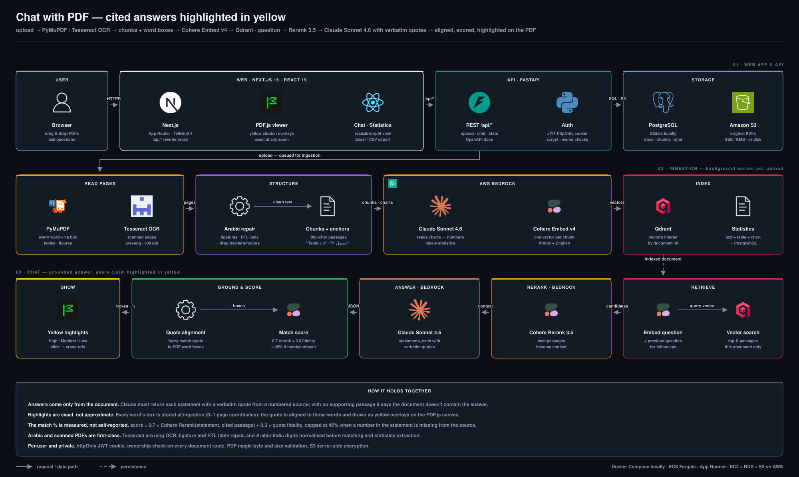

# PDF Insight

Upload PDFs (Arabic/English, scanned or digital), chat with them, extract every statistic, and verify each answer against highlighted sources.

## Architecture


## Features
- Drag & drop multi-file upload, 100+ page documents, OCR for scanned pages (Tesseract `ara+eng`)
- Tables, figures and charts (Claude vision reads charts into text + statistics)
- Statistics table with search/filter/sort and Excel/CSV export
- RAG chat: answers only from the document; every statement cites verbatim quotes
- Citations highlighted in yellow on the PDF with a match % and High / Medium / Low level
- Resizable split view, click-to-source, clickable cross-references ("Table 3.3", "جدول ٢", "المادة ٥")
- Login, per-user documents and chat history, private storage

## Stack
| Layer | Tech |
|---|---|
| Web | Next.js 16, React 19, Tailwind 4, PDF.js |
| API | FastAPI, SQLAlchemy (SQLite / PostgreSQL), PyMuPDF, Tesseract |
| AI (AWS Bedrock) | Claude Sonnet 4.6 (answers, stats labels, charts), Cohere Embed v4, Cohere Rerank 3.5 |
| Vectors | Qdrant (embedded locally, server in production) |
| Files | Local disk or S3 (SSE / KMS) |

## Run locally
```bash
# API
cd backend
python3.13 -m venv .venv && .venv/bin/pip install -r requirements.txt
cp .env.example .env          # set BEDROCK_AWS_PROFILE to a profile with Bedrock access
brew install tesseract tesseract-lang
.venv/bin/uvicorn app.main:app --port 8000

# Web (new terminal)
cd frontend && npm install && npm run dev   # http://localhost:3000
```
API docs: http://localhost:8000/api/docs

## Run with Docker
```bash
cp backend/.env.example backend/.env   # set BEDROCK_AWS_PROFILE= (empty) to use the IAM role
echo "POSTGRES_PASSWORD=$(openssl rand -hex 16)" > .env
docker compose up -d --build           # http://localhost:3000
```

## Deploy on AWS
- **Compute:** ECS Fargate or App Runner (two images), or one EC2 instance with `docker compose`
- **Data:** RDS PostgreSQL (`DATABASE_URL`), S3 bucket (`STORAGE_BACKEND=s3`, `S3_BUCKET`, optional `S3_KMS_KEY_ID`), Qdrant container or Qdrant Cloud (`QDRANT_URL`, `QDRANT_API_KEY`)
- **IAM role:** `bedrock:InvokeModel` (Sonnet, Embed v4), `bedrock:Rerank` in `RERANK_REGION`, S3 read/write on the bucket
- **Production settings:** `JWT_SECRET`, `COOKIE_SECURE=true`, `ALLOW_REGISTRATION=false` once users are created, HTTPS in front (ALB/CloudFront)
- Route `/api/*` straight to the API at the load balancer for very large uploads

## Configuration
| Variable | Default | Purpose |
|---|---|---|
| `BEDROCK_AWS_PROFILE` | – | AWS profile; empty = default credential chain / IAM role |
| `BEDROCK_REGION` / `RERANK_REGION` | us-east-1 / us-west-2 | Bedrock regions |
| `CHAT_MODEL` / `STATS_MODEL` / `EMBED_MODEL` | Sonnet 4.6 / Sonnet 4.6 / Cohere Embed v4 | Model IDs |
| `DATABASE_URL` | SQLite in `DATA_DIR` | PostgreSQL in production |
| `QDRANT_URL` | embedded | Qdrant server |
| `STORAGE_BACKEND` | local | `local` or `s3` |
| `MAX_UPLOAD_MB` | 200 | Per file |
| `OCR_LANGUAGES` / `OCR_DPI` | ara+eng / 300 | Tesseract |
| `STATS_LLM` / `CHART_VISION` | true / true | LLM labelling of statistics, chart reading |

## How the matching score works
Each answer statement cites sources with a verbatim quote. For every citation:

`score = 0.7 × Rerank(statement, cited passage) + 0.3 × quote fidelity`

- **Rerank** – Cohere Rerank 3.5 relevance of the statement to the cited passage (works across Arabic/English)
- **Quote fidelity** – fuzzy alignment of the quote against the PDF text (catches paraphrased or invented quotes)
- If the statement contains a number that does not appear in the source, the score is capped at 45%
- **High** ≥ 75%, **Medium** ≥ 50%, otherwise **Low**

## How highlighting works
Each word's box is stored at ingestion as page coordinates (0–1). The quote is aligned to the page words, the matching words are merged into one box per line, and the viewer draws those boxes as yellow overlays on the PDF.js canvas, so they stay exact at any zoom. Arabic text is repaired (broken ligatures, RTL table cells) before matching.

## Security
httpOnly session cookie (JWT), scrypt passwords, ownership checks on every document route, PDF magic-byte and size validation, CSV/Excel formula-injection guard, S3 server-side encryption.
